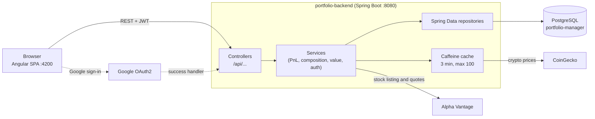
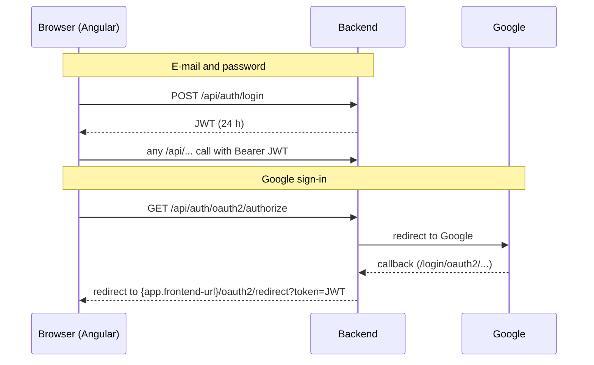
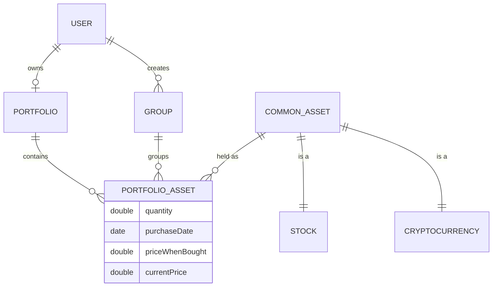

# portfolio-backend

[](https://github.com/kerekdominik/portfolio-manager/actions/workflows/sonarcloud.yml)

REST API of **portfolio-manager**, an application for tracking an investment portfolio of **stocks** and **cryptocurrencies**. Users register or sign in with Google, add the assets they hold, organise them into groups, and see profit and loss (PnL), portfolio composition and value on a dashboard.

**Stack:** Java 17, Spring Boot, Spring Security (JWT + Google OAuth2), Spring Data JPA, PostgreSQL, MapStruct, Lombok, Caffeine, springdoc-openapi (Swagger UI). The Angular client is in [`../portfolio-frontend`](../portfolio-frontend).

---

## Table of contents
- [Features](#features)
- [Architecture](#architecture)
- [Getting started (backend)](#getting-started-backend)
- [Configuration](#configuration)
- [API](#api)
- [Authentication](#authentication)
- [Data model](#data-model)
- [External data sources](#external-data-sources)
- [Testing and quality](#testing-and-quality)
- [Code conventions](#code-conventions)
- [Project structure](#project-structure)
- [Dependencies](#dependencies)
- [Database migrations](#database-migrations)
- [Running in containers](#running-in-containers)
- [Known limitations](#known-limitations)

---

## Features
- Register and log in with e-mail and password, or sign in with Google.
- Add, list, edit and delete **stocks** and **cryptocurrencies** in your portfolio (quantity, purchase date, purchase price).
- Browse the lists of tradable stocks and cryptocurrencies, and look up current and historical prices.
- Organise holdings into **groups**.
- Dashboard figures: total PnL, PnL per asset and per group, portfolio composition and portfolio values.
- Interactive API documentation (Swagger UI).

## Architecture



The backend is layered: **controller → service → repository → entity**, with DTOs at the API boundary and MapStruct for mapping. Lombok removes boilerplate. The API is stateless: every request carries a JWT.

## Getting started (backend)

### Prerequisites
- **JDK 17** (the Gradle toolchain is set to 17)
- **PostgreSQL** with an empty database named `portfolio-manager`
- A **Google OAuth2 client** (only needed for Google sign-in, but the app expects the properties to resolve at startup)
- Gradle is not required, the wrapper is included

### Run
From this folder (`portfolio-backend`):
```bash
# 1. set the environment variables (see Configuration)
export DB_USERNAME=postgres
export DB_PASSWORD=...
export JWT_SECRET_KEY=...            # at least 64 bytes, see below
export GOOGLE_CLIENT_ID=...
export GOOGLE_CLIENT_SECRET=...
export ALPHAVANTAGE_API_KEY=...      # optional, free key from alphavantage.co; without it stock data is skipped

# 2. start the API on http://localhost:8080
./gradlew bootRun
```
On Windows use `gradlew.bat bootRun`.

Then open:
- Swagger UI: <http://localhost:8080/swagger-ui.html>
- OpenAPI JSON: <http://localhost:8080/v3/api-docs>

### Build and test
```bash
./gradlew build            # compile, test, package
./gradlew test             # tests only
./gradlew test --tests "com.portfolio.service.impl.JwtServiceTest"
./gradlew jacocoTestReport # coverage report
```

> **Database:** the schema is managed by Flyway migrations (see [Database migrations](#database-migrations)), so data is kept across restarts. Start with an empty PostgreSQL database; the tables are created on the first start.

## Configuration

Settings live in [`application.properties`](src/main/resources/application.properties). Secrets are read from environment variables, so nothing sensitive is stored in the repository.

| Environment variable | Used for | Notes |
|---|---|---|
| `DB_USERNAME` | PostgreSQL user | |
| `DB_PASSWORD` | PostgreSQL password | |
| `JWT_SECRET_KEY` | Signing JWTs | At least 64 bytes for HS512. Also set as a secret in CI. |
| `GOOGLE_CLIENT_ID` | Google OAuth2 client id | |
| `GOOGLE_CLIENT_SECRET` | Google OAuth2 client secret | |
| `ALPHAVANTAGE_API_KEY` | Alpha Vantage API key | Optional. If it is not set, the stock list import is skipped (with a warning) and stock price lookups fail with a clear error. Crypto works without it. |
| `APP_FRONTEND_URL` | Public URL of the web app (`app.frontend-url`) | Optional, default `http://localhost:4200`. Where the browser is sent after a Google sign-in. |
| `APP_CORS_ALLOWED_ORIGINS` | Allowed CORS origins, comma separated | Optional, default `http://localhost:4200`. Not needed when the frontend and the API share one origin (nginx proxy in the containers). |

Fixed settings:

| Setting | Value |
|---|---|
| Database URL | `jdbc:postgresql://localhost:5432/portfolio-manager` |
| Server port | `8080` (Spring Boot default) |
| CORS allowed origin | `app.cors.allowed-origins`, default `http://localhost:4200` (methods GET, POST, PUT, DELETE, OPTIONS) |
| Frontend URL after Google sign-in | `app.frontend-url`, default `http://localhost:4200` |
| Health endpoint | `GET /actuator/health` (public, status only; nothing else of actuator is exposed) |
| JWT lifetime | 24 hours |
| Cache | Caffeine, entries expire 3 minutes after write, max 100 entries |
| Log level | `DEBUG` for `org.springframework.security` and `org.springframework.web` |

Generate a suitable JWT secret with:
```bash
openssl rand -base64 64
```

## API

All endpoints are under `/api`. Everything except `/api/auth/**` requires the header `Authorization: Bearer <token>`. The authoritative, always up-to-date reference is the Swagger UI.

| Area | Method and path | Purpose |
|---|---|---|
| **Auth** | `POST /api/auth/register` | Create an account, returns a JWT |
| | `POST /api/auth/login` | Log in with e-mail and password, returns a JWT |
| | `GET /api/auth/oauth2/authorize` | Start Google sign-in (redirect) |
| **User** | `GET /api/user/me` | Current user |
| **Stocks** | `GET /api/stock/list` | All available stocks (Alpha Vantage listing) |
| | `POST /api/stock` | Add a stock to your portfolio |
| | `GET /api/stock` | Your stocks |
| | `PUT /api/stock/{id}` | Update a holding |
| | `DELETE /api/stock/{id}` | Remove a holding |
| **Crypto** | `GET /api/crypto/list` | All available coins (CoinGecko) |
| | `GET /api/crypto/current/price?id=` | Current price in USD |
| | `GET /api/crypto/historical/price?id=&date=` | Price on a given date |
| | `POST /api/crypto` | Add a coin to your portfolio |
| | `GET /api/crypto` | Your coins |
| | `PUT /api/crypto/{id}` | Update a holding |
| | `DELETE /api/crypto/{id}` | Remove a holding |
| **Groups** | `POST /api/groups` | Create a group |
| | `GET /api/groups` | Your groups |
| | `PUT /api/groups/{id}` | Rename or update a group |
| | `DELETE /api/groups/{id}` | Delete a group |
| **Dashboard** | `GET /api/dashboard/pnl-summary` | Total PnL summary |
| | `GET /api/dashboard/portfolio-composition` | Share of each asset type |
| | `GET /api/dashboard/group-pnl` | PnL per group |
| | `GET /api/dashboard/pnl-assets` | PnL per asset |
| | `GET /api/dashboard/portfolio-values` | Portfolio values |

Example:
```bash
TOKEN=$(curl -s -X POST http://localhost:8080/api/auth/login \
  -H 'Content-Type: application/json' \
  -d '{"email":"me@example.com","password":"..."}' | jq -r .token)

curl -H "Authorization: Bearer $TOKEN" http://localhost:8080/api/dashboard/pnl-summary
```
Check the request and response fields in Swagger UI (`LoginRequestDto`, `AuthenticationResponseDto`), as this example assumes the token field is called `token`.

## Authentication



- Sessions are stateless (`SessionCreationPolicy.STATELESS`), CSRF protection is disabled because there are no cookies, and `JwtAuthFilter` validates the token on each request.
- Public paths: `/api/auth/**`, `/swagger-ui/**`, `/v3/api-docs/**`, `/login/oauth2/**`, `/oauth2/**`.
- Roles: `USER` and `ADMIN` (`Role` enum).
- Relevant classes: `SecurityConfig`, `JwtAuthFilter`, `JwtService`, `OAuth2SuccessHandler`, `OAuth2Service`, `AuthService`.

## Data model



- A user currently has **one portfolio**.
- `CommonAsset` is the abstract base (symbol, name, category). `Stock` adds `exchange`, `Crypto` adds `externalId` (the CoinGecko id). Asset categories: `STOCK`, `CRYPTOCURRENCY`.
- `StockListItem` and `CryptoListItem` hold the cached lists of available instruments.

## External data sources

| Source | Used for | Notes |
|---|---|---|
| [CoinGecko](https://www.coingecko.com/en/api) | Coin list, current and historical prices (USD) | Public API with rate limits. Price calls are cached for 3 minutes (`cryptoPriceCache`, `historicalCryptoPriceCache`). |
| [Alpha Vantage](https://www.alphavantage.co/documentation/) | Stock listing and quotes (`LISTING_STATUS`, `GLOBAL_QUOTE`) | The free tier has strict daily request limits. |

## Testing and quality
- JUnit 5, Mockito and Spring Security Test. Tests use an in-memory **H2** database configured in `src/test/resources/application-test.properties`.
- Coverage is measured with JaCoCo. Reports are written to `build/reports/jacoco/test/html/index.html` and as XML for Sonar. Line coverage is close to 100%; keep it there by adding tests with every change.
- External APIs are never called in tests: the CoinGecko and Alpha Vantage clients take an injectable `HttpClient`, so tests pass a Mockito mock.
- CI ([`.github/workflows`](../.github/workflows)) runs `./gradlew build jacocoTestReport sonar` for backend changes on every push to `main` and on pull requests (the frontend has its own workflow and SonarCloud project, `portfolio-manager-frontend`), publishing results to [SonarCloud](https://sonarcloud.io) (project `portfolio-manager-backend`). It needs the repository secrets `SONAR_TOKEN` and `JWT_SECRET_KEY`.

### Running tests
```bash
./gradlew test                                                   # all tests
./gradlew test --tests "com.portfolio.entity.UserTest"           # one class
./gradlew test --tests "com.portfolio.entity.UserTest.testBuilder"  # one method
```
On Windows use `gradlew.bat`. Coverage reports are written to `build/reports/jacoco/test/html/index.html` (HTML) and `build/reports/jacoco/test/jacocoTestReport.xml` (XML).

### Adding new tests
1. Create the test class under `src/test/java`, in the same package as the class under test.
2. Use JUnit 5 (Jupiter) and follow the existing patterns:
   - `@BeforeEach` for setup, test methods named `test...` plus the behaviour, Arrange-Act-Assert structure.
   - **Entity tests:** constructors, getters/setters, `equals`/`hashCode`, `toString`.
   - **Service tests:** mock dependencies with Mockito.
   - **Controller tests:** plain Mockito unit tests that call the controller methods directly (see `CryptoControllerTest`). Pass a fixed `Clock` when the code uses today's date.
   - **Security tests:** `SecurityConfigTest` runs the real filter chain in a `@WebMvcTest` slice.

Example entity test:
```java
class CryptoListItemTest {

    private CryptoListItem cryptoListItem;

    @BeforeEach
    void setUp() {
        cryptoListItem = new CryptoListItem();
    }

    @Test
    void testSettersAndGetters() {
        cryptoListItem.setId("ethereum");
        cryptoListItem.setSymbol("eth");
        cryptoListItem.setName("Ethereum");

        assertEquals("ethereum", cryptoListItem.getId());
        assertEquals("eth", cryptoListItem.getSymbol());
        assertEquals("Ethereum", cryptoListItem.getName());
    }
}
```

## Code conventions
- Lombok removes boilerplate. Entities carry JPA annotations, DTOs cross the layer boundaries, MapStruct converts between them.
- Services that need to be mocked or swapped are implemented behind interfaces.
- Failures of external market data APIs are reported as `ExternalApiException`; do not throw or declare plain `Exception`/`RuntimeException`.
- Get the current date and time from the injected `Clock` bean (`LocalDate.now(clock)`), never from the system default.
- Where to look: caching in `CacheConfig`, OpenAPI in `OpenApiConfig`, security in `SecurityConfig`, `JwtAuthFilter` and `OAuth2SuccessHandler`.
- Debugging: `DEBUG` logging for Spring Security and Web is on by default, tune it in `application.properties`.

## Project structure

```
src/main/java/com/portfolio
├── PortfolioBackendApplication.java
├── configuration/      # Cache, OpenAPI, application beans
│   └── security/       # SecurityConfig, JwtAuthFilter, OAuth2SuccessHandler, AuthEntryPoint
├── controller/         # REST controllers (auth, user, stock, crypto, groups, dashboard)
├── dto/                # Request/response objects, external API responses
├── exception/          # Application exceptions (ExternalApiException)
├── entity/             # JPA entities, asset hierarchy, enums
├── mapper/             # MapStruct mappers
├── repository/         # Spring Data JPA repositories
└── service/
    ├── (interfaces)    # ExternalCryptoService, ExternalStockService
    └── impl/           # Auth, JWT, OAuth2, Crypto, Stock, PnL, composition, value, external clients
```

## Dependencies
Dependency versions are pinned in `gradle.lockfile`, and every downloaded artifact is checked against the SHA-256 checksums in `gradle/verification-metadata.xml`. After changing a dependency or plugin version, regenerate both:
```bash
./gradlew --write-verification-metadata sha256 dependencies build jacocoTestReport sonarResolver --write-locks
```
Review the diff of both files before committing.

## Database migrations
The schema is owned by [Flyway](https://flywaydb.org/): SQL files in `src/main/resources/db/migration` are applied automatically at startup, and Hibernate runs with `ddl-auto=validate`, so the application refuses to start if the entities and the database disagree. Data is kept across restarts.

- **Change the schema** by adding a new file, `V2__short_description.sql`, `V3__...`. **Never edit a migration that was already applied** anywhere, Flyway checks the checksums and will fail.
- `V1__init.sql` is the baseline, generated from the entities. For a new entity or column, write the SQL by hand in the next migration (a Hibernate export, `jakarta.persistence.schema-generation.scripts.*`, is a good starting point).
- `DatabaseMigrationTest` starts a real PostgreSQL with Testcontainers (skipped when Docker is not available), applies all migrations and lets Hibernate validate them. If you change an entity without a migration, this test fails.
- Unit tests and the `test` profile use H2 with `ddl-auto=update` and Flyway switched off.

**Backups.** The data lives only in the PostgreSQL volume, deleting that volume deletes everything. Dump and restore with:
```bash
pg_dump -U <user> -h <host> portfolio-manager > portfolio-manager.sql
psql -U <user> -h <host> -d portfolio-manager < portfolio-manager.sql   # into an empty database
```
Keep `JWT_SECRET_KEY` stable as well, otherwise every issued token is invalid after a restart.

## Running in containers
The repository root has a `compose.yaml` that runs the whole app: **nginx** (serves the Angular app and forwards `/api` to the backend, the only published port), the **backend** and **PostgreSQL** with a named volume for the data. The backend and the database are reachable inside the compose network only.

```bash
cp .env.example .env        # fill in DB_PASSWORD and JWT_SECRET_KEY (openssl rand -base64 64)
docker compose up -d --build
```
Then open <http://localhost:8082> (`FRONTEND_PORT` in `.env`). Notes:
- `docker compose down` keeps the data, **`docker compose down -v` deletes the database volume**.
- Email and password login works out of the box. Google sign-in needs a real OAuth client and a redirect URI Google accepts (`localhost` or a public domain); until then the Google values stay placeholders.
- The backend image is built from `portfolio-backend/Dockerfile` (JDK build stage, JRE runtime, non-root user). The Gradle lock and verification files are copied into the build stage, so keep them committed. The container healthcheck uses `/actuator/health`.
- Without `ALPHAVANTAGE_API_KEY` the stock list import is skipped.
- Swagger UI and `/actuator/health` are not published through nginx (the healthcheck runs inside the network). To look at the API docs, run the backend locally or use `docker compose exec backend wget -qO- http://127.0.0.1:8080/v3/api-docs`.
- Local development without containers is unchanged: `./gradlew bootRun` and `ng serve`, which proxies `/api` to `localhost:8080` (`proxy.conf.json`).

## Known limitations
These are open points worth fixing, not intended behaviour:

- **Old Alpha Vantage API key is still in the git history.** The key is now read from `ALPHAVANTAGE_API_KEY`, but the previous hard-coded key can be found in old commits, so it must stay revoked at Alpha Vantage.
- **JWT in a URL.** After Google sign-in the token is passed as a query parameter, which can end up in browser history and logs.
- **Verbose logging.** `DEBUG` logging for Spring Security and Web, and `show-sql=true`, should be turned down outside development.
